# Guide des fonctionnalités d'iphotor 2

Ce guide présente les nouveautés de la version 2. Les fonctions des versions 1.x (navigation,
visionneuse, favoris, tags, EXIF, copies, thèmes) sont décrites dans le [README](../README.md).

Toutes les captures ont été faites sur une photothèque de démonstration générée.

## Repères dans l'interface

| Où | Quoi |
|---|---|
| **Sélecteur de la barre supérieure** | Trois sources : **Bibliothèque**, **Dossier**, **Collections** (albums virtuels) |
| **Panneau latéral** | **Chronologie**, *Mes favoris*, *Tags*, *Albums intelligents* et *Recherches enregistrées* (s'il y en a), *Recherche avancée* (dernier résultat) |
| **Menu Édition** | Sélection : page, vue entière, inverser, tout désélectionner, ajouter à un album virtuel, propriétés |
| **Menu Outils** | Recherche avancée, carte, statistiques, doublons, comparaison, diaporama, export, analyse des métadonnées, import des informations Apple |
| **Menu Affichage** | Thème sombre, chronologie, surveillance du dossier ouvert |
| **Menu Fichier** | Dossiers récents, dossiers favoris, nettoyage des caches obsolètes |
| **Menu Aide** | Diagnostic (dépendances, stockage, état de la source) |

---

## 1. Sélection multiple et actions groupées

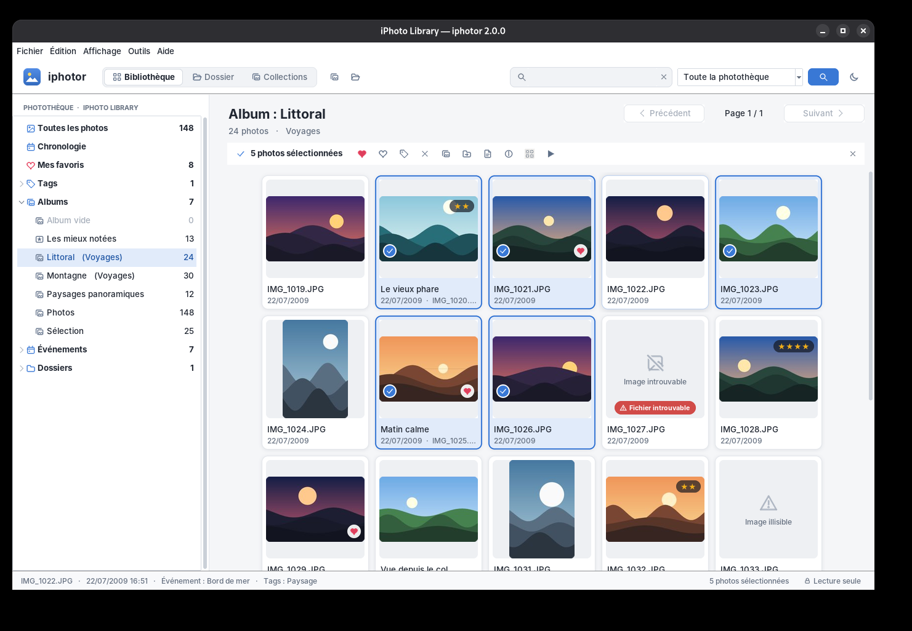

| Geste | Effet |
|---|---|
| **Ctrl + clic** | Ajoute la photo à la sélection, ou l'en retire |
| **Maj + clic** | Sélectionne toutes les photos entre la dernière photo cliquée et celle-ci, même sur plusieurs pages |
| **Ctrl + A** | Sélectionne toute la page |
| *Édition › Sélectionner toute la vue* | Sélectionne toutes les photos de l'album, de l'événement ou de la recherche |
| **Échap** | Tout désélectionne |
| Clic simple | Ouvre la visionneuse, comme avant |

Les photos sélectionnées sont encadrées en bleu et portent une coche. Le nombre de photos
sélectionnées s'affiche en bas à droite. La sélection est conservée quand on change de page ou
d'album ; elle est vidée quand on change de bibliothèque, de dossier ou de source.

La **barre de sélection**, au-dessus de la grille, propose les actions suivantes :
- ajouter aux favoris, ou retirer ;
- ajouter un ou plusieurs tags, ou retirer un tag ;
- ajouter à un album virtuel ;
- copier les fichiers vers un dossier, avec les mêmes garanties qu'en 1.4 : aucun fichier écrasé, sources intactes, progression, annulation ;
- exporter les métadonnées ;
- afficher les propriétés communes ;
- comparer deux photos ;
- lancer un diaporama.

Quand la fenêtre est étroite, les boutons n'affichent plus que leur icône ; leur info-bulle donne leur rôle.

## 2. Analyse des métadonnées

Les critères photographiques (appareil, objectif, ISO, dimensions, GPS…), les statistiques, la
carte et les doublons s'appuient sur un **index des métadonnées**. Il se construit avec
*Outils › Analyser les métadonnées*, ou à la demande depuis la recherche, les statistiques ou la carte.

L'analyse fonctionne ainsi :
- **Lecture seule** : seuls les en-têtes des fichiers sont lus.
- **Incrémentale** : une seconde analyse ne relit que les fichiers ajoutés ou modifiés.
- **Annulable et reprenable** : interrompue, elle repart là où elle s'était arrêtée.
- **Progression affichée**, avec le temps restant estimé.

Une photo non encore analysée n'est **jamais** comptée comme « sans GPS » ou « sans EXIF » : la
recherche et les statistiques indiquent combien de photos restent à analyser.

## 3. Recherche avancée

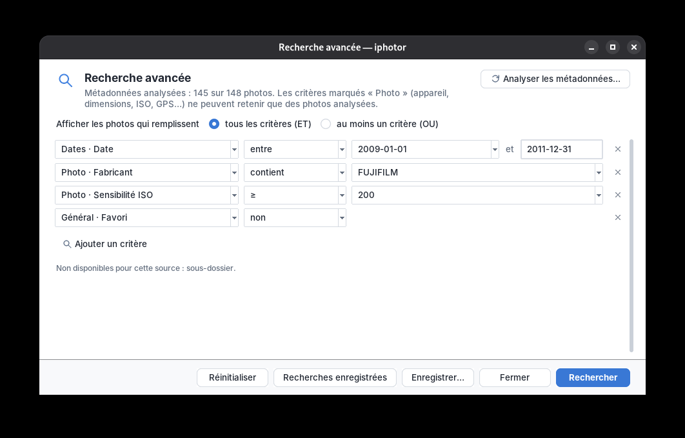

*Outils › Recherche avancée…* (**Ctrl+Maj+F**).

Chaque ligne est un critère. On peut en ajouter autant qu'on veut, et choisir de les combiner
par **ET** (tous) ou par **OU** (au moins un). Les dates se saisissent au format `AAAA-MM-JJ` ou
`JJ/MM/AAAA`. Les nombres acceptent `2,8`, `f/2.8` ou `1/125`.

| Famille | Critères |
|---|---|
| Général | nom du fichier, extension, type (photo/vidéo), légende, commentaire, événement, album, sous-dossier (mode dossier), tag, favori, note, mot-clé / personne / lieu Apple (après import) |
| Dates | date (le, avant, après, entre, année, mois, jour), date de prise de vue EXIF |
| Photo | largeur, hauteur, résolution (Mpx), orientation, ratio, taille du fichier, fabricant, modèle, objectif, focale (réelle ou 24×36), ouverture, temps de pose, ISO |
| Autres | présence de coordonnées GPS, fichier RAW, présence de métadonnées EXIF |

Un critère qui n'existe pas pour la source ouverte n'est pas proposé. Par exemple, l'événement
ou la note n'existent pas pour un simple dossier : ces critères sont listés sous le formulaire.

Les résultats s'affichent dans la grille, avec le nombre de photos. L'entrée **Recherche
avancée** du panneau latéral permet d'y revenir. Les critères restent en mémoire : la fenêtre
s'ouvre avec les derniers utilisés.

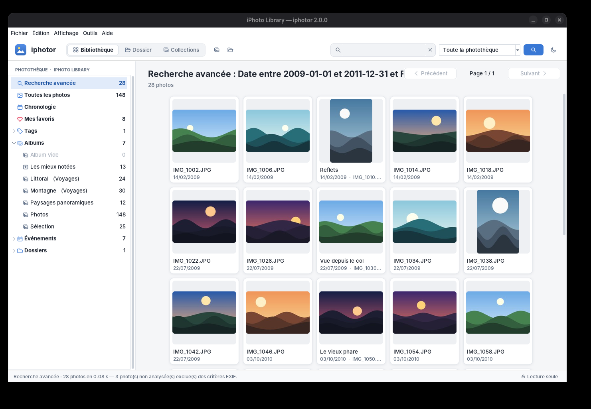

- **Enregistrer… › Enregistrer comme recherche** : la recherche apparaît dans *Recherches
  enregistrées* (panneau latéral) et dans le bouton *Recherches enregistrées* de la fenêtre.
- **Enregistrer… › Créer un album intelligent** : voir § 5.

## 4. Chronologie

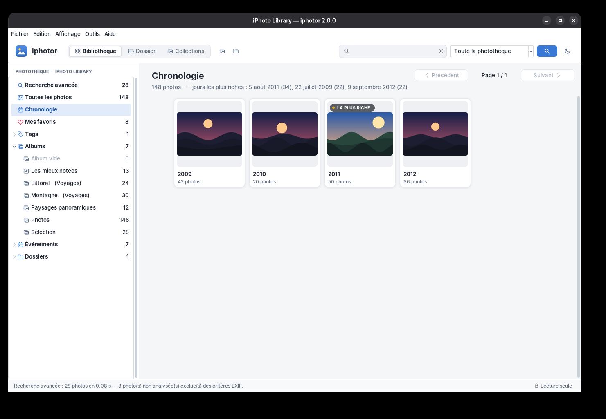

Entrée **Chronologie** du panneau latéral, dans les modes Bibliothèque et Dossier :
- **Années** : nombre de photos, photo représentative, périodes sans photo (« 2013 – 2015 »),
  années les plus riches, photos sans date exploitable.
- Clic sur une année : les **12 mois**, y compris les mois vides, grisés.
- Clic sur un mois : les **jours** ayant des photos.
- Clic sur un jour : ses photos dans la grille.

Le bouton **Retour** remonte d'un niveau. Le sous-titre indique les jours les plus riches de la
photothèque. Les miniatures sont chargées au fur et à mesure, comme dans la grille. Les dates
manquantes ou aberrantes (avant 1900, ou dans le futur) sont regroupées dans « Date inconnue ».

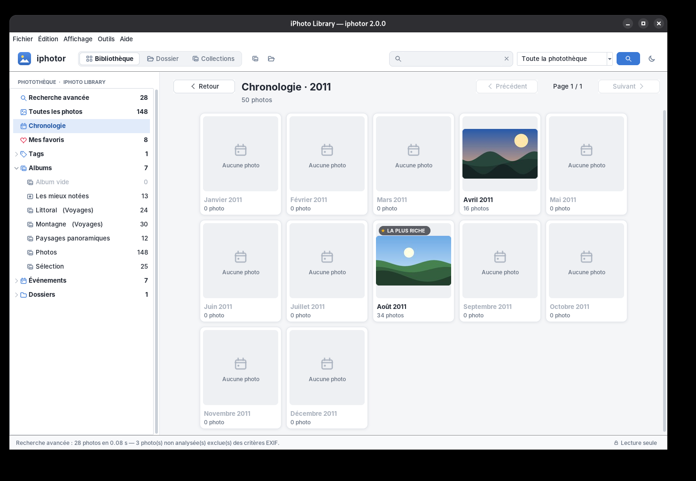

## 5. Albums virtuels et albums intelligents

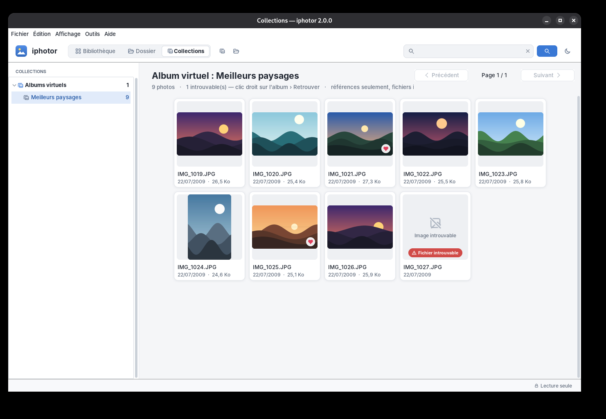

Un **album virtuel** regroupe des photos de plusieurs bibliothèques et dossiers, sans copier ni
déplacer aucun fichier : il ne contient que des références.

| Action | Comment |
|---|---|
| Créer, ajouter des photos | Sélection › **Album virtuel** (album existant ou nouveau), ou *Outils › Nouvel album virtuel* |
| Consulter | Source **Collections** (sélecteur de la barre supérieure) |
| Renommer, supprimer, propriétés | Clic droit sur l'album |
| Retirer des photos | Clic droit sur une photo, ou sélection › *Retirer de l'album* |
| Réorganiser | Sélection › flèches ‹ › |
| Retrouver des photos introuvables | Clic droit › *Retrouver les photos introuvables…* : chemin remplacé si le disque a changé de nom, sinon recherche par nom **et** taille dans le dossier choisi |
| Diaporama, copie, export | Clic droit sur l'album |

Supprimer un album virtuel ne supprime **aucune** photo. Les favoris et tags posés dans
Collections sont ceux de la photo d'origine.

Un **album intelligent** est un nom associé à des critères de recherche. Il se recalcule à
chaque ouverture : une photo ajoutée aux favoris ou analysée y apparaît automatiquement. Il se
crée depuis la recherche avancée et figure dans le panneau latéral. Le clic droit permet de
modifier ses critères, de le renommer ou de le supprimer.

## 6. Carte des photos géolocalisées

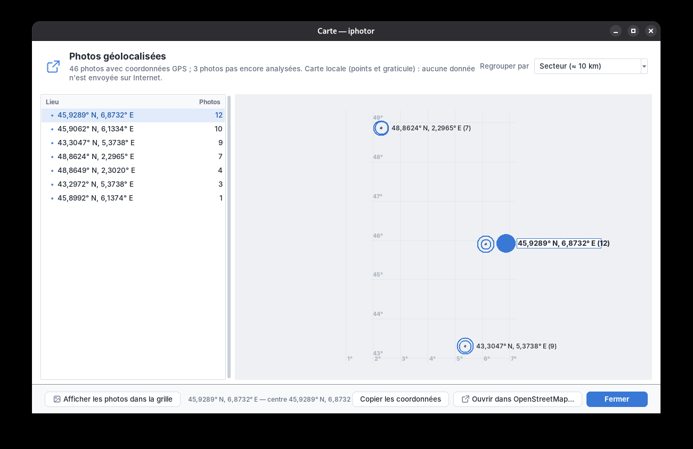

*Outils › Carte des photos géolocalisées*. Les photos ayant des coordonnées GPS EXIF sont
regroupées par **zone** (≈ 100 km), **secteur** (≈ 10 km) ou **lieu** (≈ 1 km).

La carte est **locale** : points et graticule. Aucune donnée n'est téléchargée ni envoyée. Les
noms de lieux ne sont affichés que s'ils proviennent de la bibliothèque Apple (§ 10). Sinon ce
sont les coordonnées : iphotor n'invente pas de lieu.

| Bouton | Effet |
|---|---|
| *Afficher les photos dans la grille* | Photos du groupe choisi |
| *Copier les coordonnées* | Coordonnées du groupe dans le presse-papiers |
| *Ouvrir dans OpenStreetMap…* | Ouvre le navigateur après confirmation explicite, car la position est alors envoyée au site |

## 7. Comparaison

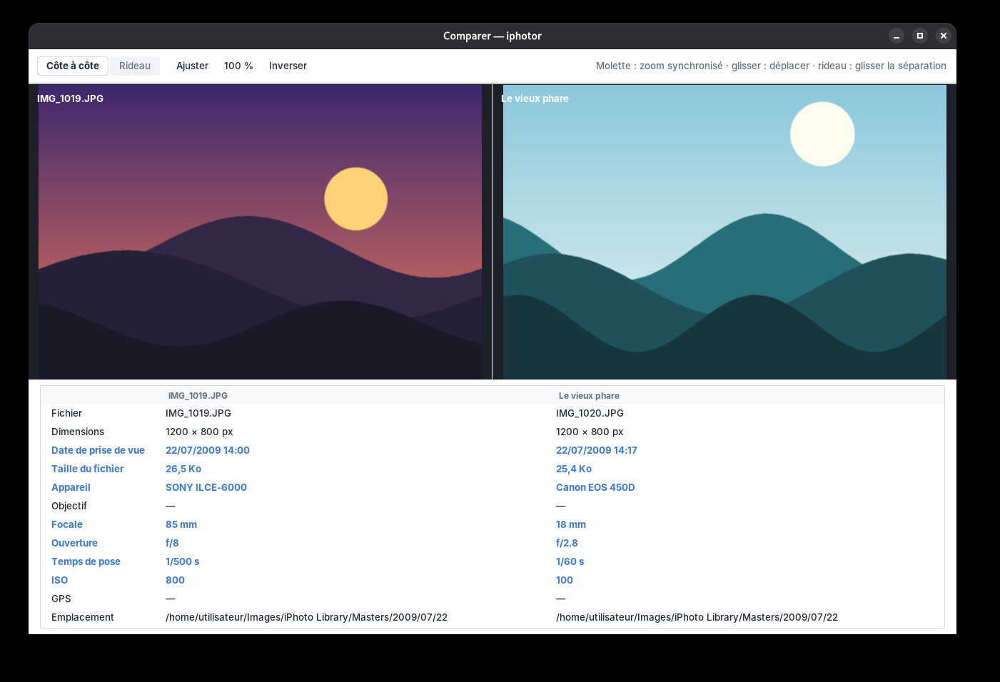

Sélectionnez deux photos (Ctrl+clic) puis **Comparer**. La comparaison se lance aussi depuis la
fenêtre des doublons.

**Côte à côte** :
- zoom (molette) et déplacement (glisser) synchronisés ;
- boutons *Ajuster* et *100 %* ;
- *Inverser* les deux photos.

**Rideau** : une seule image dont la séparation se déplace à la souris.

Le tableau du bas compare fichier, dimensions, dates, taille, appareil, objectif et réglages ;
les différences sont en bleu. Les images sont chargées à une taille adaptée à l'écran, au plus
2 600 px, pour ménager la mémoire.

## 8. Doublons

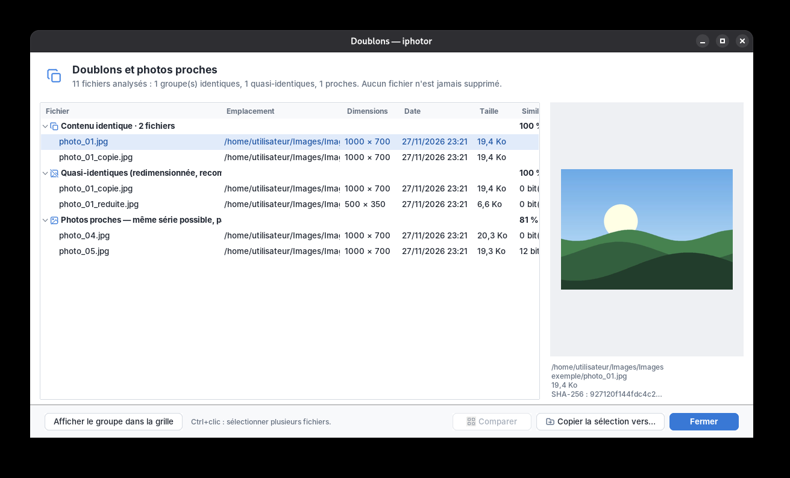

*Outils › Rechercher les doublons…*. L'analyse porte sur la sélection (si au moins 2 photos sont
sélectionnées), sinon sur la vue ou sur toute la source. Trois niveaux :

| Niveau | Signification |
|---|---|
| **Contenu identique** | Empreinte SHA-256 égale : même fichier, quel que soit son nom ou son emplacement |
| **Quasi-identiques** | Empreinte visuelle à 6 bits d'écart ou moins sur 64 : même image redimensionnée, recompressée ou légèrement retouchée |
| **Photos proches** | Jusqu'à 12 bits d'écart, entre photos voisines dans le temps : même série de prises de vue. Ce ne sont **pas** des doublons. |

**Aucune suppression n'est proposée.** On peut :
- prévisualiser une photo ;
- en comparer deux ;
- afficher le groupe dans la grille ;
- **copier les versions retenues** vers un dossier choisi.

Les empreintes calculées sont conservées : une nouvelle analyse est bien plus rapide. Les
derniers résultats se rouvrent avec *Outils › Derniers résultats de doublons*.

## 9. Statistiques

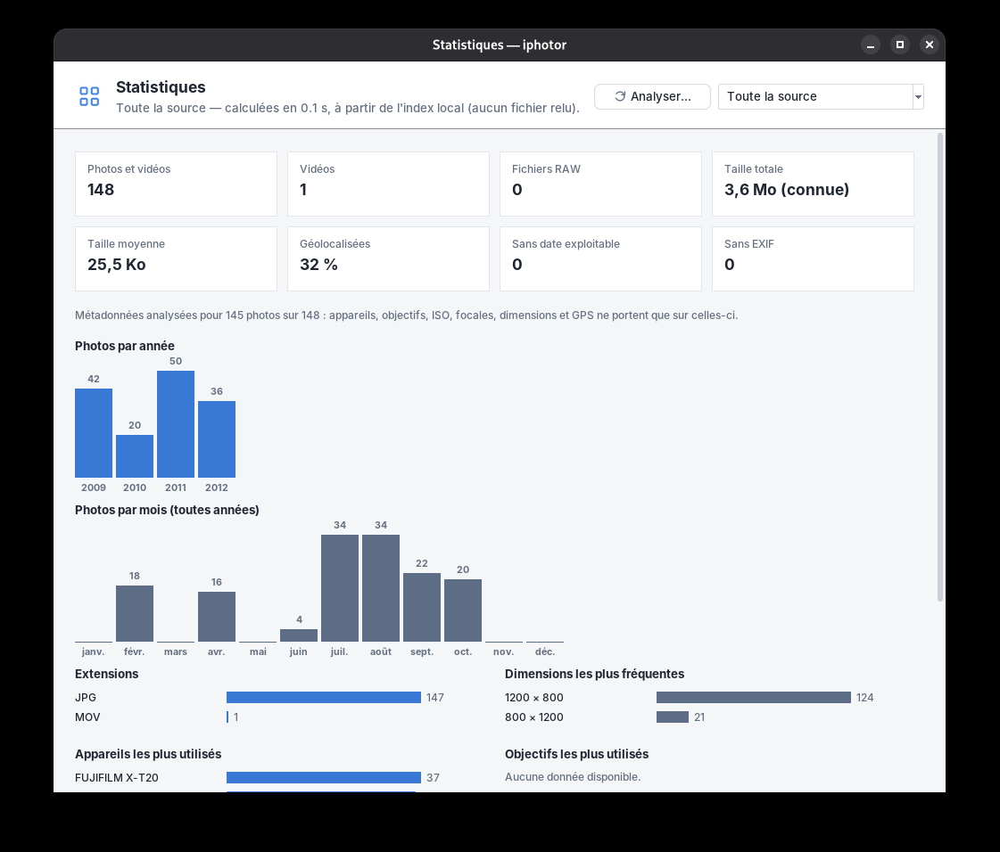

*Outils › Statistiques*. La portée se choisit : source entière, vue affichée ou sélection.

Indicateurs affichés :
- photos et vidéos, RAW ;
- tailles totale et moyenne ;
- part de photos géolocalisées, photos sans date, photos sans EXIF ;
- répartitions par année et par mois, par extension, par dimensions, par appareil, par objectif, par ISO et par focale.

Tout est calculé à partir de l'index local, sans relire les fichiers. Le résultat est mis en
cache tant que rien ne change.

## 10. Mots-clés, personnes et lieux des bibliothèques Apple

*Outils › Importer mots-clés, personnes et lieux Apple…* (mode Bibliothèque). Les bases Apple
qui contiennent ces informations sont **copiées dans le cache** puis lues ; elles ne sont jamais
ouvertes sur place :
- `Library.apdb`, `Properties.apdb` et `Faces.db` pour iPhoto 9.x ;
- `photos.db` pour Photos 1 à 4.

Les tables sont détectées : une information absente est ignorée, rien n'est inventé.

Les termes importés :
- s'affichent sous la photo dans la visionneuse ;
- servent de critères dans la recherche avancée ;
- donnent leurs noms aux lieux de la carte.

Cette lecture est **expérimentale** : elle a été vérifiée sur des bases de test reproduisant les
schémas connus, pas sur des bibliothèques réelles de toutes les versions.

## 11. Diaporama

*Outils › Diaporama*. Il porte sur la sélection (si plusieurs photos sont sélectionnées) ou sur
la vue ; il se lance aussi par clic droit sur un album virtuel. Il s'ouvre en plein écran et les
images sont adaptées à l'écran, avec préchargement de la suivante.

| Touche | Effet |
|---|---|
| Espace | Pause / reprise |
| ← → (ou clic gauche / droit) | Photo précédente / suivante |
| + / − | Intervalle (1 à 60 s, mémorisé) |
| I | Informations sur la photo |
| L | Boucle |
| F | Plein écran |
| Échap | Quitter |

L'ordre aléatoire se règle avec la clé `slideshow_order` (`"random"`) de `config.json`.

## 12. Export des métadonnées

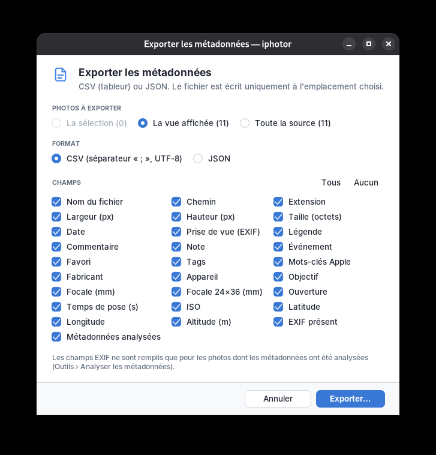

*Outils › Exporter les métadonnées…*. L'export est aussi accessible depuis la barre de sélection
et le clic droit sur un album virtuel.

On choisit :
- la portée : sélection, vue ou source entière ;
- le format : **CSV** (séparateur « ; », UTF-8, pour un tableur) ou **JSON** ;
- les champs à exporter.

Le fichier n'est écrit qu'à l'emplacement choisi, et jamais dans une source.

## 13. Dossiers

| Fonction | Où |
|---|---|
| **Dossiers récents** | *Fichier › Dossiers récents* |
| **Dossiers favoris** | *Fichier › Dossiers favoris* : ajouter ou retirer le dossier ouvert |
| **Changements depuis la dernière visite** | À l'ouverture d'un dossier, la barre d'état indique le nombre d'images nouvelles, disparues ou modifiées |
| **Surveillance** | *Affichage › Surveiller le dossier ouvert* : relit la liste des fichiers toutes les 30 s et signale un changement ; F5 actualise. Facultative, et passive : aucun fichier n'est modifié, aucun processus ne reste en arrière-plan après fermeture |

Les fichiers RAW (CR2, NEF, ARW, DNG, PEF, SRW) et HEIC sont maintenant affichés en mode dossier.
Un format qui ne peut pas être décodé est signalé sur sa vignette.

## 14. Disques externes

Une bibliothèque sur disque externe est surveillée toutes les 5 s. Si le disque disparaît :
- la barre d'état le signale ;
- l'index reste consultable ;
- les vignettes en cache restent visibles ;
- la visionneuse affiche un message clair.

Au retour du disque, les fichiers sont relus automatiquement. Aucun chemin n'est supposé valide
simplement parce qu'il figure dans l'index : l'existence est vérifiée à chaque accès.

## 15. Maintenance et diagnostic

- **Aide › Diagnostic** : dépendances obligatoires et facultatives, emplacements et tailles du
  stockage local, état de la source, couverture des métadonnées, références introuvables des
  albums virtuels.
- **Fichier › Nettoyer les caches obsolètes…** : supprime l'index et les miniatures des
  bibliothèques qui n'existent plus et ne sont pas récentes. Seul le cache est concerné.
- **Ligne de commande** :
  - `iphotor --diagnostic` : nouveau ;
  - `--verifier`, `--reindexer`, `--bibliotheque` : inchangés.
