# Rapport — Modernisation de l'interface d'iphotor (version 1.5.0)

Ce rapport décrit la refonte visuelle d'iphotor entre la version 1.4.0 et la version 1.5.0.
Le travail porte uniquement sur la présentation : aucune fonctionnalité n'a été ajoutée ni
retirée, à l'exception d'un thème sombre facultatif. Les raccourcis clavier, la logique métier
et les règles de lecture seule sont inchangés.

Toutes les captures ont été faites sur une **photothèque de démonstration générée** (images
synthétiques, 148 photos, 7 événements, 8 albums) et sur un dossier d'images de démonstration.
Elles ne contiennent aucune photo ni aucun chemin réel.

---

## 1. État initial (v1.4.0)

| Fenêtre principale | Visionneuse |
|---|---|
| 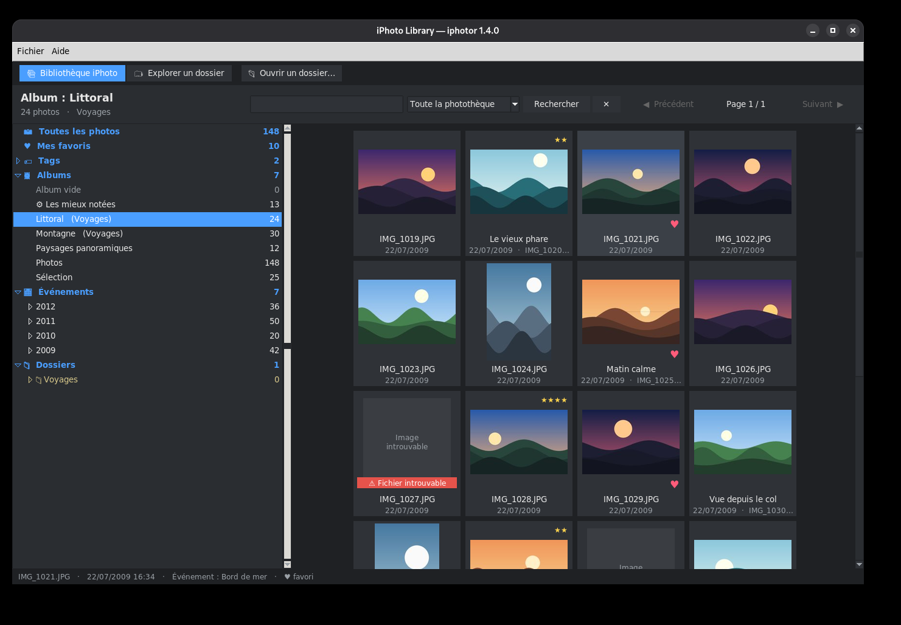 | 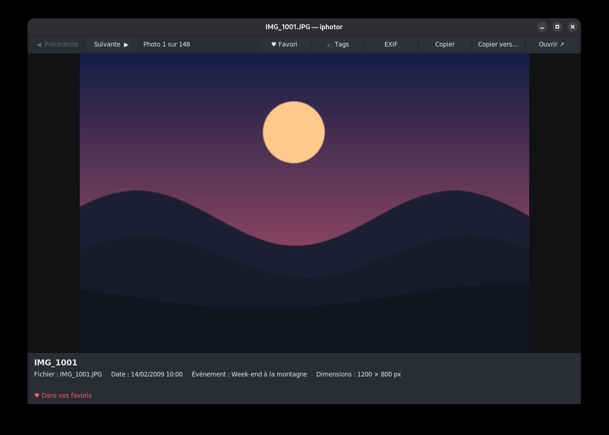 |

| Fenêtre réduite (900 × 560) | Copie vers un dossier |
|---|---|
| 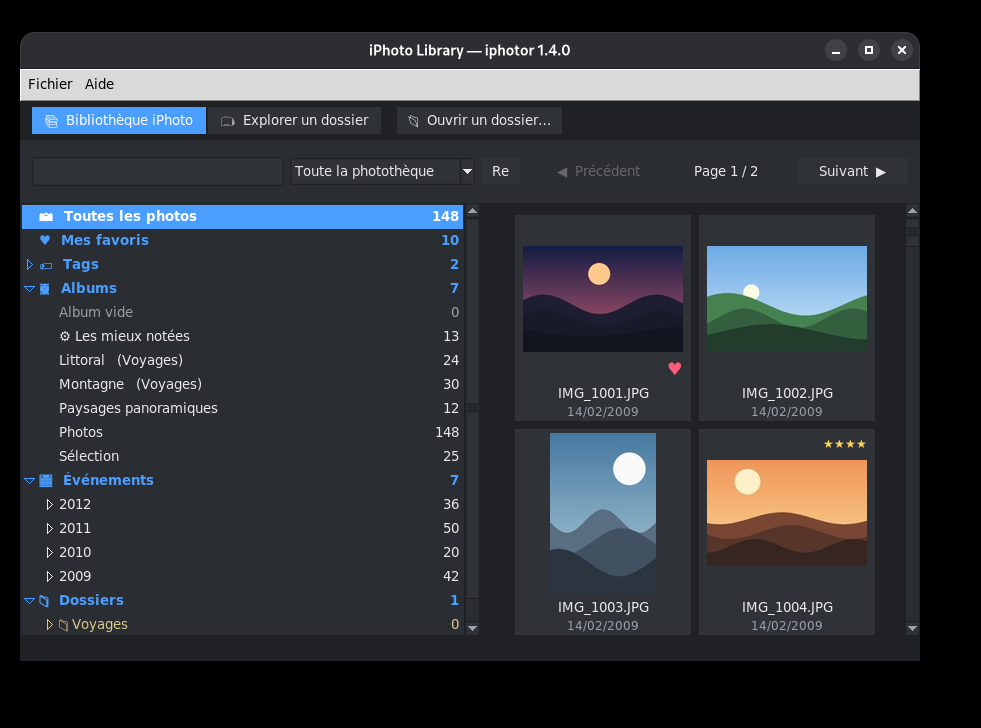 | 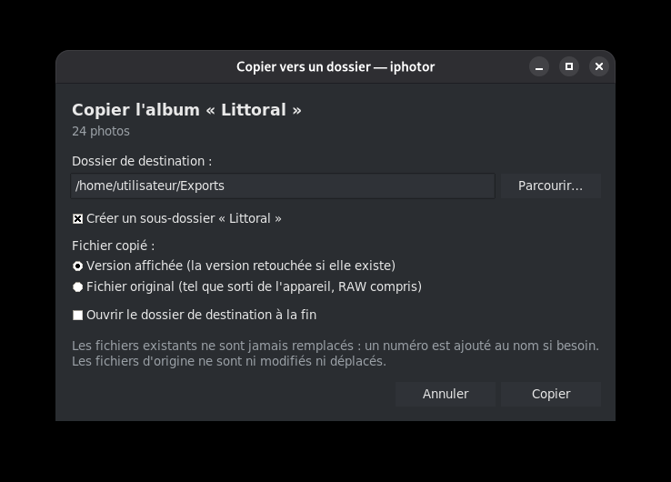 |

Autres captures de référence : [toutes les photos](captures/avant/01_principale_toutes.png),
[mode dossier](captures/avant/08_mode_dossier.png), [tags](captures/avant/05_tags.png),
[EXIF](captures/avant/06_exif.png), [bibliothèques](captures/avant/10_bibliotheques.png).

### Constats de l'audit

| Domaine | Constat |
|---|---|
| Couleurs | Thème sombre unique, gris plats ; couleurs codées en dur à plusieurs endroits (`#d8c88a`, `#7fd17f`, `#ffd34d`, `#111214`, `#666`). Deux valeurs par défaut de paramètres (`color=COLORS["muted"]`) figées au chargement du module. |
| Icônes | Mélange d'emojis (📷 🖼 📅 📁 🗂 🏷 🔍 📚 📂) et de symboles Unicode (♥ ♡ ⚙ ◀ ▶ ✕ ↗ ⚠). Tk ne sait pas afficher les emojis en couleur : certains apparaissaient comme des glyphes de substitution de tailles différentes. |
| Boutons | Rectangles plats sans bordure ; pas d'état de focus clavier ; pas de distinction entre action principale et secondaire. |
| Barre supérieure | Deux barres empilées (modes, puis titre + recherche + pagination). Sous 1 100 px de large, le titre disparaissait et le bouton « Rechercher » était tronqué (« Re »). |
| Panneau latéral | Rubriques en bleu gras, flèches de dépliage triangulaires du thème `clam`, largeur initiale de 460 px (un tiers de la fenêtre). |
| Galerie | Cases rectangulaires plates ; miniatures à angles vifs ; badge « ▶ VIDÉO » orange vif, bandeau rouge « ⚠ Fichier introuvable », étoiles et cœur en glyphes. |
| Visionneuse | Huit boutons de même poids, sans icônes ; fond quasi noir ; aucune indication dans la grille de la photo affichée. |
| Fenêtres secondaires | Titre en gras puis contenu ; boutons alignés à droite sans hiérarchie ; pas de pied de fenêtre. |
| Barre d'état | Texte gris sur le fond, sans séparation. |

### Fichiers et fonctions de rendu identifiés

Toute l'interface se trouve dans `iphotor.py`, section « Interface graphique » :
- `COLORS` et `MainWindow._setup_style` : couleurs et styles ttk ;
- `MainWindow._build_ui` : menus, barres, panneau latéral, grille ;
- `_populate_tree`, `_populate_ftree`, `_refresh_annotations_tree`, `do_search` : libellés et icônes de l'arborescence ;
- `_draw_tile`, `_set_hover`, `_show_grid_message`, `_poll_thumbnails` : grille de vignettes (Canvas) ;
- `PhotoViewer` : visionneuse ;
- `LibraryDialog`, `_Dialog`, `TagDialog`, `ExifDialog`, `CopyDialog`, `CopyProgress` : fenêtres secondaires ;
- `photo_menu`, `_on_tree_menu` : menus contextuels.

### Risques de régression identifiés

- Les libellés de l'arborescence étaient relus par le code (`label.lstrip("📷🖼…")` dans le menu
  contextuel, texte affiché dans la barre d'état).
- `_apply_mode_widgets` réorganise des widgets selon le mode (recherche, options du mode dossier).
- Les raccourcis sont liés à `root` et à la visionneuse : il ne fallait en perdre aucun.
- La grille est redessinée à chaque redimensionnement, survol et changement de favori : le
  rendu devait rester rapide.

---

## 2. Design system

Tout est centralisé en tête de la section « Interface graphique » de `iphotor.py`.

### Palettes (`PALETTES`, `COLORS`)

| Rôle | Clair | Sombre |
|---|---|---|
| Fond principal (galerie) | `#F5F6F8` | `#171A21` |
| Panneaux (barres, panneau latéral, fenêtres) | `#FFFFFF` | `#202530` |
| Cartes (vignettes) | `#FFFFFF` | `#272E3A` |
| Texte principal | `#202631` | `#EDF1F7` |
| Texte secondaire | `#646F7F` ¹ | `#A0AABA` |
| Accent (bouton principal, sélection) | `#3978D5` | `#3370CF` (fond), `#6AA6FF` (texte) |
| Sélection douce | `#E1EBFA` / texte `#1D54A3` | `#253957` / texte `#D2E3FF` |
| Bleu-gris secondaire (icônes) | `#5D6D85` | `#93A3BC` |
| Séparateurs | `#E3E6EB` | `#2D3440` |
| Favori / erreur / vidéo / note | `#DE3F5C` / `#CF3F3B` / `#D97F16` / `#F0AE1A` | `#FF6B86` / `#F06A64` / `#F2A145` / `#F7C445` |
| Fond de la visionneuse | `#1D2026` | `#111318` |

¹ Le cahier des charges proposait `#788392`. Ce gris n'atteint que 3,8:1 sur blanc, sous le
seuil WCAG AA de 4,5:1 pour un petit texte. Il a été légèrement assombri (4,7:1 sur les panneaux,
4,5:1 sur le fond).

`COLORS` contient la palette courante et est **modifié en place** lors d'un changement de thème.
Aucune couleur n'est plus codée en dur dans les widgets.

### Typographie (`setup_fonts`)

Une seule famille système, choisie dans l'ordre : Inter, Cantarell, Noto Sans, Ubuntu,
Open Sans, DejaVu Sans, Liberation Sans. C'est Cantarell sur une installation GNOME de Debian 13.

| Usage | Taille / graisse |
|---|---|
| Titre de la vue (en-tête de la galerie) | 16 gras |
| Titre de fenêtre secondaire, légende de la visionneuse, marque | 13 gras |
| Texte courant, noms d'albums, boutons | 10 |
| Rubriques du panneau latéral, bouton principal | 10 gras |
| Métadonnées, barre d'état | 9 |
| Libellés de section (« DOSSIER DE DESTINATION ») et badges | 8 gras |

Les polices nommées de Tk (`TkDefaultFont`, `TkMenuFont`, `TkHeadingFont`…) sont alignées sur
cette famille : les menus et les boîtes de message suivent.

### Espacements

Une échelle unique : 4, 8, 12, 16, 24 px (`SPACE_XS` à `SPACE_XL`).

### Icônes (`draw_icon`, `Icons`)

Un jeu de 31 icônes au trait est dessiné par Pillow, sur une grille de 24 unités avec traits
arrondis, suréchantillonnage ×4 puis réduction. Elles ne dépendent d'aucun fichier, d'aucune
police et d'aucun accès réseau.

Le jeu comprend : photos, album, album intelligent, événement, dossier, dossier ouvert,
« copier vers », cœur (contour et plein), tag, dièse, recherche, fermer, chevrons, infos,
copier, fichier, ouvrir à l'extérieur, vidéo, lecture, alerte, image indisponible,
bibliothèque, soleil, lune, cadenas, étoile, coche, actualiser, ainsi que le logo.

`Icons.get(nom, taille, rôle)` renvoie un `PhotoImage` mis en cache. Le rôle est une clé de la
palette. Au changement de thème, `Icons.refresh()` repeint chaque image en place avec
`PhotoImage.paste` : aucun widget n'a besoin d'être reconfiguré.

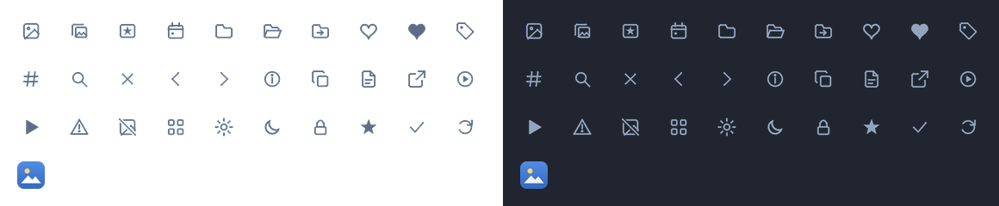

### Composants ttk (`Theme`)

Base `clam`, plus des éléments « image » dessinés par `rounded_image()` (rectangles arrondis
anticrénelés) :

| Style | Rendu |
|---|---|
| `TButton` | Bouton secondaire : blanc, bordure grise, coins de 7 px, états survol, pressé, désactivé et focus clavier (bordure bleue) |
| `Accent.TButton` | Bouton principal bleu, texte blanc gras |
| `Ghost.TButton`, `Icon.TButton` | Boutons d'outils transparents, fond au survol |
| `Segment.TFrame` + `Segment.Toolbutton` | Sélecteur de mode segmenté |
| `Search.TFrame` / `SearchFocus.TFrame` | Champ de recherche arrondi, bordure bleue au focus |
| `TCheckbutton`, `TRadiobutton` | Cases et boutons radio arrondis, cochés en bleu |
| `Treeview` (`Sidebar.Treeview`) | Lignes de 28 à 30 px, chevrons fins, sélection bleu doux |
| `Vertical.TScrollbar`, `Grid.Vertical.TScrollbar` | Barres fines (12 px), poignée arrondie, sans flèches |
| `Horizontal.TProgressbar` | Barre de 8 px, arrondie |
| Libellés | `Heading`, `Title`, `Muted`, `Small`, `Section`, `Status`, `Chip`, etc. |

Les menus Tk, les listes des listes déroulantes et les boîtes de message suivent la palette
grâce à la base d'options de Tk.

---

## 3. Composants modernisés

### Fenêtre principale

| Clair | Sombre |
|---|---|
| 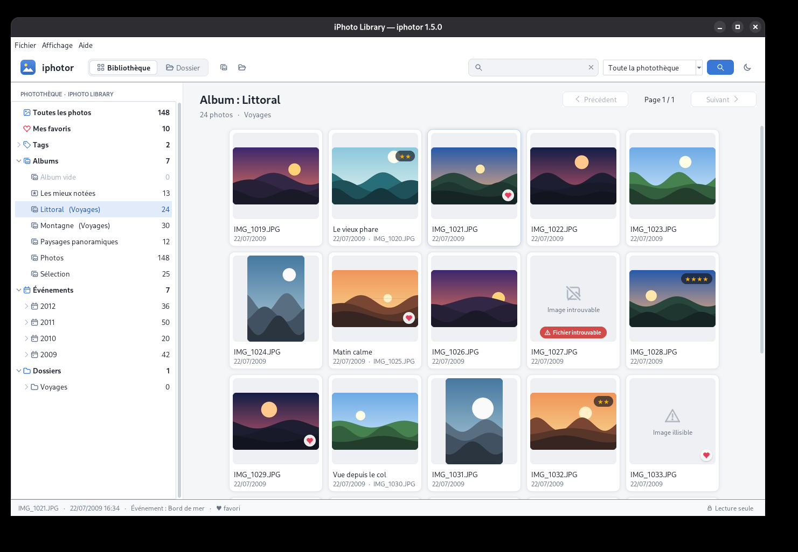 | 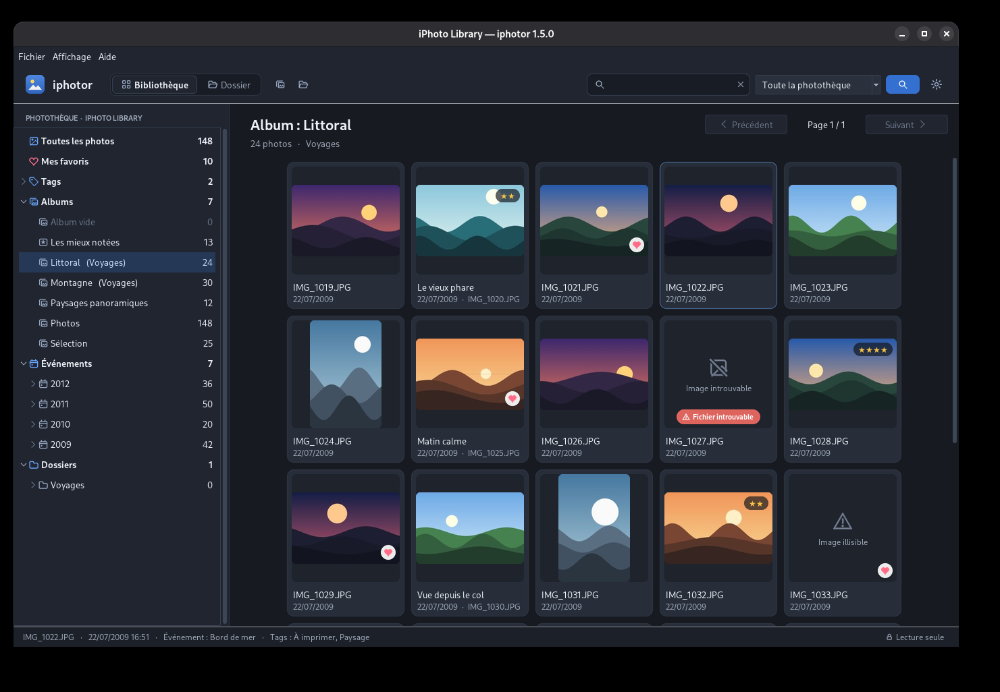 |

- **Barre supérieure unique** :
  - logo et nom ;
  - sélecteur de mode segmenté (Bibliothèque / Dossier) ;
  - *Ouvrir une bibliothèque…* et *Ouvrir un dossier…*, le premier étant nouveau dans la barre (il n'existait que dans le menu) ;
  - champ de recherche arrondi avec loupe et bouton d'effacement, portée de la recherche, bouton principal *Rechercher* ;
  - bascule clair/sombre.
- **Adaptation à la largeur**, sur trois paliers :
  - au-delà de 1 480 px, tout est affiché ;
  - au-delà de 1 180 px, les deux boutons d'ouverture passent en icône seule et les libellés de mode sont raccourcis ;
  - en dessous, le nom disparaît, la recherche se resserre et le bouton *Rechercher* devient une loupe.
  
  Une info-bulle rappelle le rôle et le raccourci de chaque bouton réduit.
- **Panneau latéral** :
  - 320 px au lieu de 460 ;
  - en-tête « PHOTOTHÈQUE · NOM » ou « DOSSIER · NOM » ;
  - icônes bleues pour les rubriques et bleu-gris pour les éléments ;
  - chevrons fins ;
  - sélection bleu doux, survol des lignes ;
  - albums vides en gris clair.
- **En-tête de contenu** au-dessus de la grille :
  - titre de la vue en 16 gras et sous-titre (nombre de photos, chemin, date) ;
  - pagination « ‹ Précédent · Page 1 / 2 · Suivant › ».
- **Mode dossier** : les options (sous-dossiers, tri) passent dans une barre de filtres dédiée,
  sous l'en-tête.

  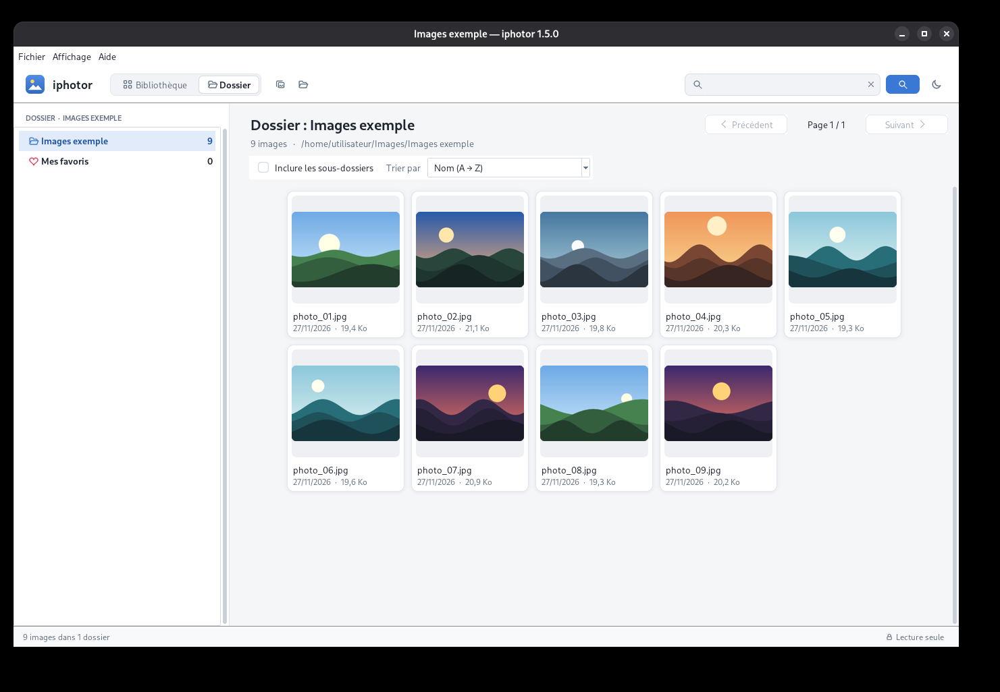
- **Galerie** :
  - chaque photo est une carte arrondie (10 px) avec ombre douce ;
  - la miniature est centrée dans une zone carrée neutre, avec des coins arrondis, et ses proportions sont respectées ;
  - nom en 10, date et informations en 9 gris.
- **États de la galerie** :
  - survol : bordure bleue claire, ombre plus marquée ;
  - photo affichée dans la visionneuse : bordure bleue de 2 px (nouvel indicateur purement visuel) ;
  - favori : pastille blanche avec cœur rouge ;
  - vidéo : pastille sombre « ▶ VIDÉO » ;
  - note : étoiles sur pastille sombre ;
  - fichier introuvable : pastille rouge avec icône d'alerte et texte ;
  - image illisible ou indisponible : icône et libellé dans la zone de la miniature.
  
  Aucun état n'est signalé par la seule couleur : chaque badge a une icône et un texte, ou une forme.
- **Messages de la grille** (indexation, erreurs, zone vide) : grande icône discrète au-dessus
  du texte.
- **Barre d'état** : fond légèrement teinté, séparateur, texte en 9 gris, et à droite
  l'indicateur permanent « Lecture seule » avec cadenas, accompagné d'une info-bulle explicative.
- **Densité conservée** : la pagination et la limite de 100 photos par page sont inchangées.
  La largeur d'une vignette est inchangée (184 px). Sa hauteur passe de 214 à 228 px pour
  aérer la légende.

### Visionneuse

| Clair | Sombre |
|---|---|
| 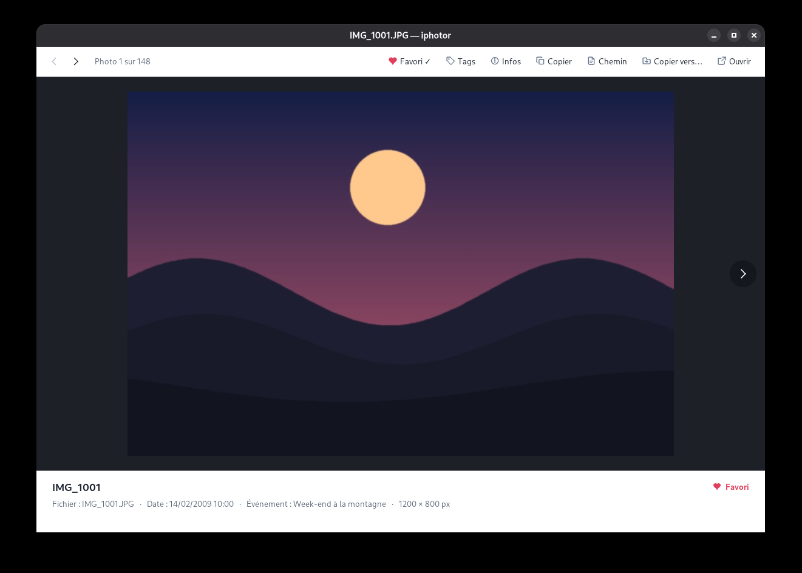 | 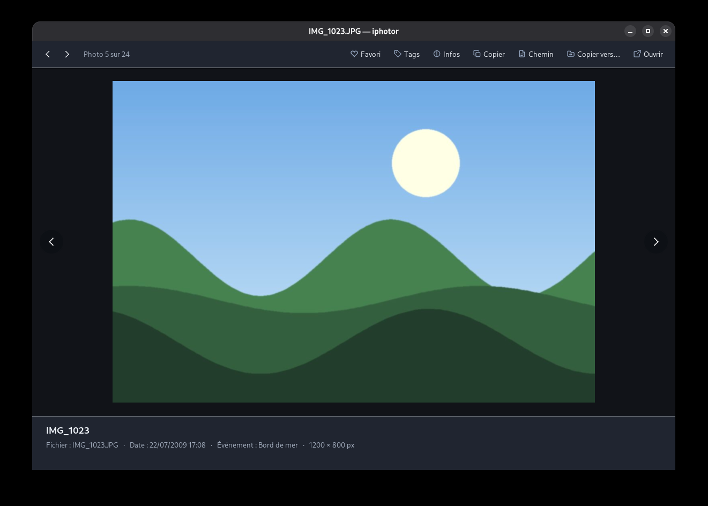 |

- **Barre d'outils** :
  - chevrons précédente/suivante et position (« Photo 1 sur 148 ») à gauche ;
  - à droite, barre d'actions à icônes : Favori (cœur plein quand la photo est favorite), Tags, Infos, Copier, Chemin, Copier vers…, Ouvrir ;
  - chaque bouton a une info-bulle avec son raccourci ;
  - sous 1 080 px, les actions passent en icônes seules.
  
  Le bouton « Chemin » rend visible l'action *Copier le chemin*, qui n'était accessible que
  par Ctrl+Maj+C et le menu contextuel.
- **Zone d'image** : fond neutre sombre, photo centrée avec une marge de 24 px, flèches
  rondes semi-transparentes en surimpression pour passer à la photo précédente ou suivante.
  La note d'origine (aperçu RAW, version retouchée, vidéo) s'affiche dans une pastille en bas à gauche.
- **Informations** : nom ou légende en 13 gras ; détails en gris séparés par « · » (fichier,
  date, note, événement, dimensions) ; commentaire ou chemin en 9 ; pastilles « ♥ Favori »
  et tags à droite du titre.

### Fenêtres secondaires

| Copie (clair) | Copie (sombre) |
|---|---|
| 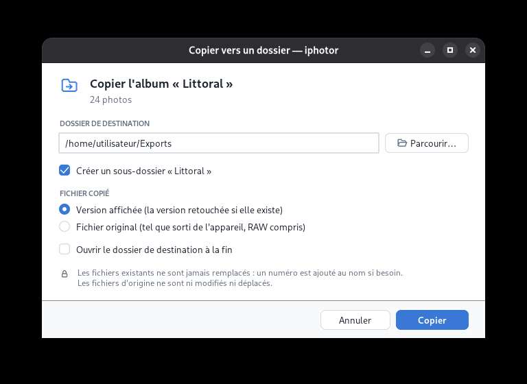 | 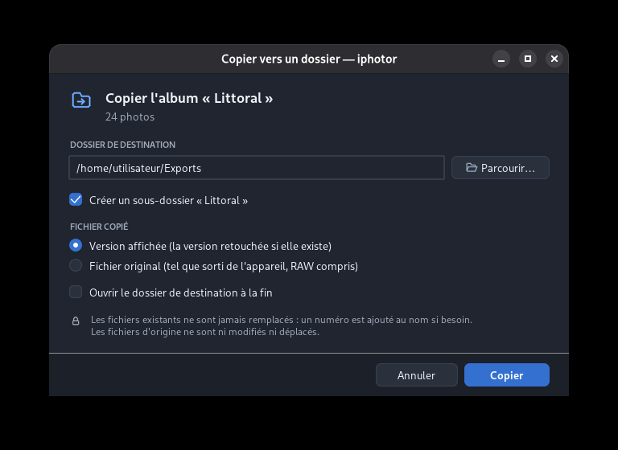 |

| Tags | EXIF | Bibliothèques |
|---|---|---|
| 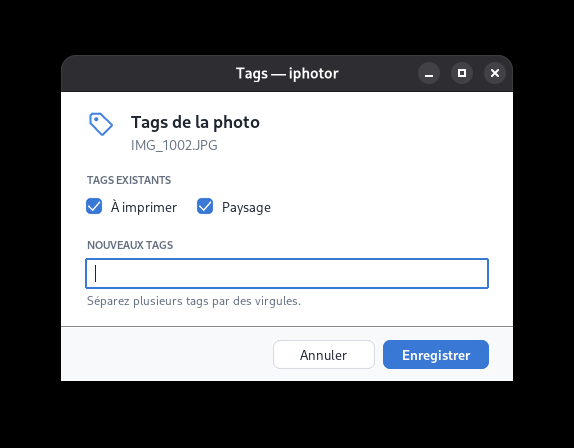 | 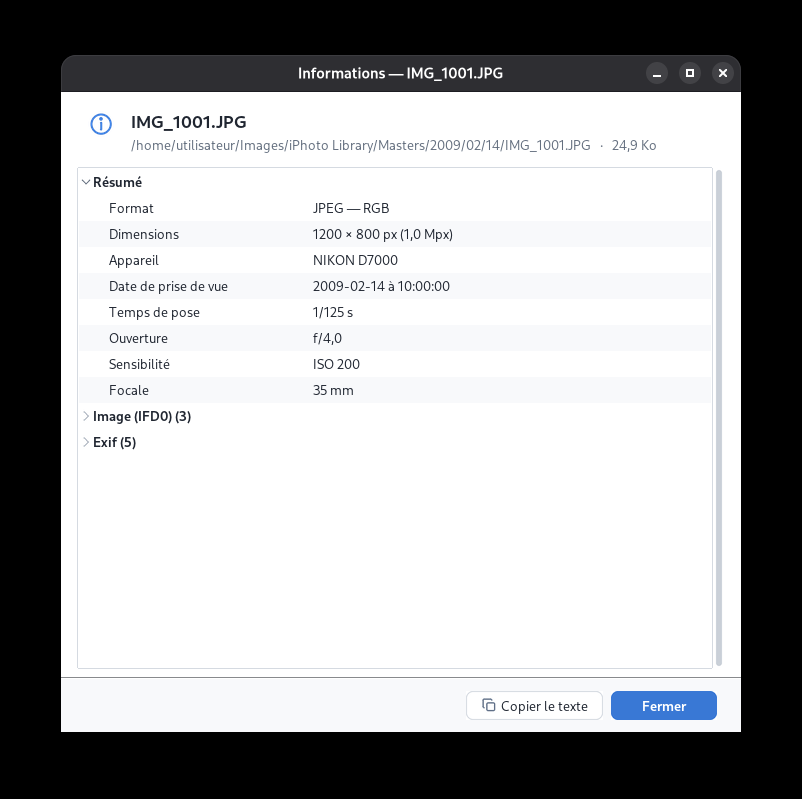 | 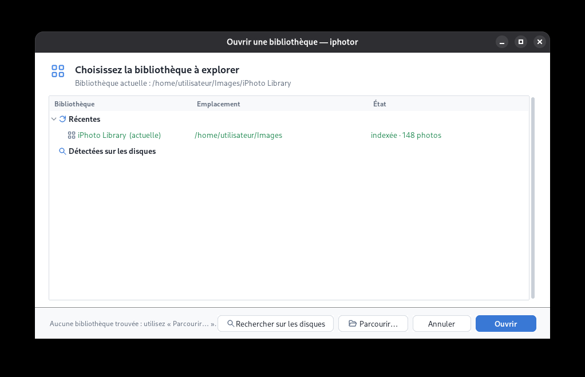 |

Structure commune (`_Dialog`) :
- un en-tête avec une icône bleue de 28 px, un titre en 13 gras et un sous-titre gris ;
- un corps avec des libellés de section en petites capitales grises ;
- un pied de fenêtre teinté et séparé, avec le bouton principal bleu à droite et le bouton secondaire à sa gauche.

Adaptations propres à chaque fenêtre :
- **EXIF** : lignes alternées pour la lecture.
- **Copie** : rappel des garanties de lecture seule avec un cadenas.
- **Progression** : barre arrondie, compteur en gris, *Annuler* dans le pied.
- **Bibliothèques** : en-têtes de colonnes discrets, bibliothèque actuelle en vert.

Les boîtes de message (`messagebox`) et le sélecteur de dossier restent ceux de Tk, comme le
demandait le cahier des charges. Ils prennent seulement la police et les couleurs de la palette.

### Menus contextuels

Les icônes sont alignées avec les entrées : copier, chemin, copier vers, favori, tags et infos.
Les raccourcis restent affichés à droite.

---

## 4. Améliorations ergonomiques

- **Hiérarchie des actions** : un seul bouton bleu par zone (Rechercher, Copier, Enregistrer,
  Ouvrir, Fermer). Les actions secondaires sont blanches ; les outils sont transparents et
  prennent un fond au survol.
- **Zones cliquables** d'au moins 30 px de haut, et lignes de 30 px dans le panneau latéral.
- **Retour visuel** :
  - survol des vignettes et des lignes ;
  - bordure de focus clavier sur les boutons et champs ;
  - cœur plein immédiat dans la visionneuse ;
  - photo courante encadrée dans la grille ;
  - message dans la barre d'état après chaque action, comme avant.
- **Redimensionnement** : plus aucun élément tronqué ou masqué entre 900 px et 1 920 px de large.
  La partie droite de la barre (recherche) est prioritaire, et les libellés se réduisent par paliers.
- **Contrastes** : texte principal à 14:1 ou plus, texte secondaire à 4,5:1 ou plus,
  bouton principal à 4,4:1 en clair (le bleu du cahier des charges, texte gras) et 4,8:1 en sombre.
- **Thème sombre** : *Affichage › Thème sombre*, ou le bouton lune/soleil. Le choix est
  mémorisé (`theme` dans `~/.config/iphotor/config.json`). Le changement est immédiat, sans
  redémarrage : la palette, les images des éléments et les icônes sont repeintes en place.
- **Pas d'animation** : seule la barre d'indexation indéterminée, qui existait déjà, est animée.

---

## 5. Fichiers modifiés

| Fichier | Modification |
|---|---|
| `iphotor.py` | Design system : `PALETTES`, `COLORS`, `rounded_image`, `draw_icon`, `draw_logo`, `Icons`, `Theme`, `setup_fonts`, `Tooltip`. Refonte de la présentation de `MainWindow`, `PhotoViewer` et des fenêtres secondaires. `Settings.theme`. `APP_VERSION = "1.5.0"`. |
| `packaging/iphotor.svg` | Nouvelle icône d'application, assortie au logo. |
| `packaging/iphotor.desktop` | Mot-clé « galerie ». |
| `README.md`, `CHANGELOG.md`, `CONTEXT.md` | Version 1.5.0, thème, architecture du design system. |
| `docs/rapport-modernisation-design.md`, `docs/captures/` | Ce rapport et ses captures. |

**Hors interface, `iphotor.py` ne change qu'en trois points** :
- le champ `theme` de `Settings` (lecture et écriture) ;
- la constante `TILE_H` (214 → 228) ;
- les imports `math` et `ImageDraw`.

Les fonctions suivantes sont identiques octet pour octet (vérifié par différence) :
- lecture des bibliothèques, indexation, recherche, miniatures (`ThumbnailLoader`) ;
- `Annotations`, `read_exif`, `CopyTask`, presse-papiers ;
- `verify()` et `main()`.

---

## 6. Dépendances

**Aucune dépendance ajoutée.** Tout repose sur Tkinter et Pillow, déjà requis.
`ImageDraw` fait partie de Pillow. Aucune ressource n'est chargée depuis Internet, aucun fichier
d'image n'est ajouté au programme : l'application reste un fichier unique.

---

## 7. Tests réalisés

Environnement : Debian 13, Tk 8.6.16, Pillow 11.1, session GNOME sous Wayland (XWayland).
Les préférences, le cache et les données de test étaient isolés dans un dossier temporaire :
les préférences, favoris et caches réels n'ont pas été touchés.

### Test fonctionnel de bout en bout (47 vérifications)

Le script pilote l'application réelle sur la photothèque de démonstration :

| Domaine | Vérifications | Résultat |
|---|---|---|
| Ouverture d'une bibliothèque iPhoto | index construit, 148 photos, 100 par page, 2 pages, vignettes chargées en arrière-plan | ✔ |
| États des vignettes | vidéo, fichier introuvable, image illisible détectés et affichés | ✔ |
| Raccourcis | tous présents dans la fenêtre principale, les raccourcis globaux et la visionneuse | ✔ |
| Pagination | page suivante, touche Page préc. | ✔ |
| Navigation | album, année d'événements | ✔ |
| Recherche | résultats, effacement | ✔ |
| Visionneuse | ouverture, image chargée, → / ← , synchronisation de page, mise en évidence dans la grille, actions en icônes en fenêtre étroite, fermeture | ✔ |
| Favoris | touche F, compteur, vue « Mes favoris » | ✔ |
| Tags | dialogue, enregistrement, rubrique « Tags » | ✔ |
| EXIF | fenêtre, appareil lu | ✔ |
| Copies | une photo ; un album avec sous-dossier ; annulation sans fichier partiel ; copie vers la bibliothèque refusée | ✔ |
| Thèmes | sombre puis clair, mémorisation | ✔ |
| Redimensionnement | 900×560, 1100×700, 1920×1080, 1400×860 : recherche, bouton *Rechercher*, pagination et titre visibles | ✔ |
| Mode dossier | analyse, sous-dossiers, barre d'options, recherche, tri, favori, retour au mode bibliothèque | ✔ |
| Messages | message d'erreur dans la grille | ✔ |
| **Lecture seule** | empreinte SHA-256, taille et date de **chaque fichier et dossier** de la bibliothèque et du dossier exploré, avant et après : **identiques** | ✔ |
| Stabilité | aucune exception Tk pendant tout le test | ✔ |

**Résultat : 47/47.**

### Autres vérifications

- **Raccourcis clavier** : la liste complète des liaisons a été comparée entre la version
  1.4.0 et la version 1.5.0 (fenêtre principale, liaisons globales, visionneuse). Elle est
  **identique**.
- **Performances**, sur une page de 100 vignettes :

  | Mesure | v1.4.0 | v1.5.0 |
  |---|---|---|
  | Redessin complet de la grille | 15 ms | 36 ms |
  | Survol d'une vignette | 0,26 ms | 0,36 ms |
  | Mémoire maximale du processus | 81 Mo | 81 Mo |

  Le redessin complet, lors d'un redimensionnement ou d'un changement de page, reste sous le
  seuil perceptible. Le chargement des miniatures reste dans les mêmes 4 threads, sans
  changement.
- **`--verifier`** sur la photothèque de démonstration : « cohérent ✔ ».
- **Palettes** : toutes les clés de couleur et tous les rôles d'icônes utilisés existent dans
  les deux palettes.
- **Captures avant/après** : produites automatiquement par le même script de pilotage, sur les
  deux versions.

---

## 8. Points restant à résoudre ou à surveiller

- **Boîtes de message et sélecteur de dossier** : ce sont ceux de Tk sous X11. Ils prennent la
  police et les couleurs, mais restent moins soignés que le reste. Les remplacer par des
  fenêtres maison est possible, mais n'a pas été fait pour ne pas dégrader leur
  fonctionnement.
- **Barre de menus** : elle est dessinée par Tk et suit la palette, mais ne peut pas être
  intégrée dans la barre supérieure.
- **Nombres du panneau latéral** : Treeview ne permet pas de colorer une seule colonne. Les
  nombres ont donc la couleur de leur ligne, et non un gris discret.
- **Bibliothèques Photos 1 à 4** : le rendu est le même code que pour iPhoto (mêmes vues, même
  grille). Faute de bibliothèque Photos de démonstration, il n'a pas été capturé séparément.
  La logique de lecture n'a pas été modifiée.
- **Écrans HiDPI** : les icônes sont dessinées à taille fixe (14 à 48 px). Avec une mise à
  l'échelle de Tk supérieure à 1, elles resteraient nettes mais relativement petites. Une
  taille dépendant de `tk scaling` serait une amélioration possible.
- **Rendu de la grille** : il est plus coûteux qu'avant (36 ms contre 15 ms), mais reste fluide.
  Sur une machine très ancienne, le redimensionnement continu de la fenêtre pourrait être un
  peu moins réactif ; le redessin est déjà différé de 80 ms.
